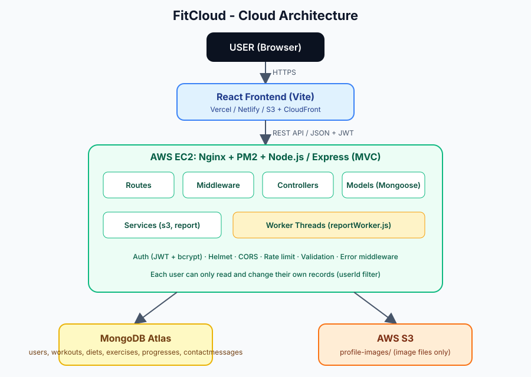

# FitCloud

**Cloud-Based Fitness and Health Management System** (Cloud Computing Open-Ended Lab)

FitCloud is a distributed web application. A React frontend talks to a Node.js/Express REST API over HTTPS. Data lives in MongoDB Atlas, profile pictures in AWS S3, and heavy report generation runs in Node.js Worker Threads. Frontend and backend are separate and deployable independently.

## Project Overview

Users register, log in and manage their own **workout plans, diet (meals), exercises and body progress**. A dashboard summarises everything with real data and charts, and reports can be exported as CSV or Excel. The idea is based on a simple PHP/MySQL fitness app (FitApp) and was rebuilt as a cloud architecture.

## Problem Statement

Many people track fitness in notebooks, messages and scattered spreadsheets. Data is lost, hard to compare over time and not available on every device. A traditional single-server PHP + MySQL app is also hard to scale, deploy in parts and secure properly. FitCloud solves this with a cloud-based, API-driven design.

## Objectives

1. Build a REST API with MVC architecture.
2. Use a cloud database (MongoDB Atlas) and cloud file storage (AWS S3).
3. Secure the system with JWT, bcrypt, validation, rate limiting and per-user data isolation.
4. Demonstrate multithreading with Node.js Worker Threads.
5. Provide a modern responsive frontend that talks to the API only through REST.
6. Make the system testable (Postman, automated scripts) and deployable on AWS.

## Features

| Area | What works |
|---|---|
| Public site | Home, About, Features, Contact (stores messages in MongoDB), FAQ accordion, Login, Register |
| Auth | Register (with optional picture), login, JWT, protected routes, session-expired handling |
| Dashboard | Totals (workouts, active/completed goals, meals, exercises), today's workout and diet, calories by meal type, progress summary, 3 charts, recent items. All from one `GET /api/dashboard` call |
| Workouts | CRUD, search by name, filter by type and status, quick status change, progress 0-100% (status and progress stay in sync) |
| Diet | CRUD, filter by meal type and date, calorie totals per meal type (MongoDB aggregation) |
| Exercises | CRUD, search, filter by type |
| Progress | CRUD, weight / workouts / calories / progress % charts from real data |
| Profile | Update name, email, level, picture (stored on S3, old picture deleted) |
| Reports | Workouts, diet, exercises, progress, or everything as CSV or XLSX, built in a worker thread |
| Security | bcrypt, JWT, Helmet, CORS, rate limits, express-validator, NoSQL-injection sanitising, ownership checks, CSV formula-injection protection |
| UX | Sidebar dashboard, modals, confirmation dialogs, toasts, loading, empty and error states, responsive layout |
| Optional | `npm run seed` demo data |

"Active goals" and "Completed goals" are derived from workouts with status *In Progress* and *Completed* (there is no separate Goals module).

## Technologies

- **Frontend:** React 18, Vite, React Router 6, Axios, Recharts, lucide-react, custom CSS (no UI framework)
- **Backend:** Node.js, Express 4, Mongoose, Multer, ExcelJS, Worker Threads
- **Database:** MongoDB Atlas
- **Storage:** AWS S3 (`@aws-sdk/client-s3`)
- **Security:** bcrypt, jsonwebtoken, Helmet, cors, express-rate-limit, express-validator, express-mongo-sanitize
- **Deployment:** AWS EC2 + Nginx + PM2, frontend on Vercel / Netlify / S3 + CloudFront
- **Testing:** Postman (+ Newman), Node smoke-test script, optional jsdom UI test
- **Tools:** Git, GitHub, VS Code

## Architecture



```
USER -> HTTPS -> REACT FRONTEND -> REST API / JSON (JWT) -> NODE.JS + EXPRESS (MVC)
                                                              |-- Routes -> Middleware -> Controllers
                                                              |-- Models (Mongoose)
                                                              |-- Services (s3Service, reportService, nutritionService)
                                                              '-- Worker Threads (reportWorker.js)
                                                                    |                |
                                                              MongoDB Atlas      AWS S3
```

Request flow: the browser calls the API with `Authorization: Bearer <token>`. The route runs middleware (rate limit, auth, validation), the controller does the work using models and services, and the error middleware turns any error into `{ "success": false, "message": "..." }`.

## Folder Structure

```
FitCloud/
├── backend/
│   ├── config/database.js            MongoDB Atlas connection
│   ├── controllers/                  auth, workout, diet, exercise, progress, contact, report, dashboard
│   ├── middleware/                   authMiddleware, errorMiddleware, validationMiddleware, uploadMiddleware
│   ├── models/                       User, Workout, Diet, Exercise, Progress, ContactMessage
│   ├── routes/                       one file per controller
│   ├── services/                     s3Service, reportService (worker pool), nutritionService
│   ├── workers/reportWorker.js       Worker Thread that builds CSV/XLSX
│   ├── utils/                        validation, AppError, asyncHandler, queryHelpers
│   ├── seed/seed.js                  optional demo data
│   ├── tests/api.smoke.js            API test script
│   ├── ecosystem.config.js           PM2 config
│   └── server.js                     setup + route mounting only
├── frontend/
│   ├── src/
│   │   ├── components/               Navbar, Footer, Sidebar, Modal, Feedback (loading/empty/error), ProtectedRoute ...
│   │   ├── pages/                    Home, About, Features, Contact, FAQ, Login, Register, Dashboard, Workouts, Diet, Exercises, Progress, Reports, Profile
│   │   ├── layouts/                  PublicLayout, DashboardLayout
│   │   ├── services/                 api.js (axios + interceptors), apiServices.js
│   │   ├── context/                  AuthContext, ToastContext
│   │   ├── hooks/                    useFetch, useForm, useDebounce
│   │   ├── config/api.js             API base URL from VITE_API_URL
│   │   └── utils/                    validators, format
│   └── tests/ui.flow.test.jsx        optional UI flow test
├── docs/                             AWS_DEPLOYMENT.md, architecture.svg
├── postman/                          collection + environments
├── screenshots/                      screenshot checklist
├── README.md  PROJECT_REPORT.md  VIVA_QUESTIONS.md
└── .gitignore  .env.example
```

## Database Design

Six collections, all with timestamps (`createdAt`, `updatedAt`).

| Collection | Main fields | Indexes |
|---|---|---|
| `users` | name, email (unique, lowercase), password (bcrypt hash, hidden), fitnessLevel, profileImage (S3 URL), profileImageKey | unique `email` |
| `workouts` | userId, planName, description, type, duration, goal, status, progress, date | `userId+createdAt`, `userId+status`, `userId+type` |
| `diets` | userId, mealName, mealType, calories, description, date | `userId+date`, `userId+mealType` |
| `exercises` | userId, name, type, duration, description | `userId+createdAt`, `userId+type` |
| `progresses` | userId, weight, workoutCompleted, calories, progressPercentage, date | `userId+date` |
| `contactmessages` | name, email, phone, subject, message | `createdAt` |

Dates are stored at UTC midnight. Images are never stored in MongoDB, only their S3 URL and key.

## REST API Documentation

Base URL: `http://localhost:5000/api`. Every response is JSON: `{ "success": true|false, "message": "...", "data": ... }`. Protected routes need `Authorization: Bearer <token>`.

| Method | Endpoint | Auth | Description |
|---|---|---|---|
| GET | `/health` | no | health check |
| POST | `/auth/register` | no | multipart: name, email, password, confirmPassword, fitnessLevel, profileImage (optional) → 201 `{ user, token }` |
| POST | `/auth/login` | no | `{ email, password }` → `{ user, token }` |
| GET | `/auth/profile` | yes | current user |
| PUT | `/auth/profile` | yes | multipart: name, email, fitnessLevel, profileImage |
| POST / GET | `/workouts` | yes | create / list (`?search=&type=&status=`) |
| GET / PUT / DELETE | `/workouts/:id` | yes | read / update / delete one |
| POST / GET | `/diet` | yes | create / list (`?mealType=&date=YYYY-MM-DD`) |
| GET | `/diet/summary` | yes | calories total and per meal type (`?date=`) |
| GET / PUT / DELETE | `/diet/:id` | yes | read / update / delete one |
| POST / GET | `/exercises` | yes | create / list (`?search=&type=`) |
| GET / PUT / DELETE | `/exercises/:id` | yes | read / update / delete one |
| POST / GET | `/progress` | yes | create / list (`?sort=asc\|desc`) |
| PUT / DELETE | `/progress/:id` | yes | update / delete one |
| POST | `/contact` | no | store a contact message (rate limited) |
| GET | `/dashboard` | yes | all dashboard data (`?date=YYYY-MM-DD` = user's today) |
| GET | `/reports/workouts`, `/diet`, `/progress`, `/exercises` | yes | download (`?format=csv\|xlsx`) |
| GET | `/reports/export` | yes | `?type=all\|workouts\|diet\|exercises\|progress&format=csv\|xlsx` |

Status codes used: 200, 201, 400 (validation), 401 (no/invalid/expired token, wrong login), 404 (not found or not yours), 409 (duplicate email), 429 (rate limit), 503 (S3 not configured), 500 (server error).

Example error: `{ "success": false, "message": "Workout not found" }`

## Authentication

1. Register: password is hashed with **bcrypt** (10 salt rounds); a **JWT** (default 7 days) is returned.
2. Login: the same generic message ("Invalid email or password") is returned for a wrong email or password.
3. The frontend keeps the token in `localStorage` and an Axios interceptor adds `Authorization: Bearer <token>` to every request. (An httpOnly cookie is more resistant to XSS but needs extra CORS/CSRF setup; this trade-off is discussed in the report.)
4. `middleware/authMiddleware.js` verifies the token and loads the user into `req.user`. Missing, invalid or expired tokens get **401**.
5. If a token expires, the frontend shows "Session expired. Please login again." and redirects to `/login`.

## Security

- bcrypt password hashing; password never returned (`select: false` + `toJSON` transform)
- JWT with secret from environment variable
- **Per-user data isolation:** every query includes `userId: req.user._id`, so another user's record returns 404
- Whitelisted fields on create/update (mass-assignment protection; a client cannot set `userId`)
- express-validator on every input; Mongoose validation as a second layer
- `express-mongo-sanitize` against NoSQL operator injection; regex search text is escaped
- Helmet headers, CORS limited to `CLIENT_URL`, global and per-route rate limits (login and contact stricter)
- Upload checks: type (mimetype + extension), size ≤ 2 MB, memory storage
- CSV formula-injection protection in exports
- Secrets only in `.env` (git-ignored). `.env.example` has no real values

## Multithreading

`backend/workers/reportWorker.js` runs in a Node.js **Worker Thread**. The report controller fetches the user's data and `services/reportService.js` passes it to the worker, which formats every row, escapes CSV, or builds and styles the XLSX workbook and returns the file buffer. This keeps the single main thread free to serve other requests. A small **worker pool** (max 2 threads, others queue, 30 s timeout) prevents too many threads. Each report response includes headers (`X-Report-Generated-By: worker-thread`, `X-Worker-Thread-Id`, `X-Worker-Time-Ms`) and the Reports page displays them as proof.

## AWS Architecture

| Service | Use |
|---|---|
| EC2 | runs the Node.js API (Nginx reverse proxy + PM2) |
| S3 | profile images under `profile-images/<userId>/...` |
| IAM | least-privilege user or role (`PutObject`, `DeleteObject` on `profile-images/*`) |
| Security Group | 22 (my IP), 80, 443 only |
| (optional) CloudFront | HTTPS and caching for the frontend or images |

Full steps: [`docs/AWS_DEPLOYMENT.md`](docs/AWS_DEPLOYMENT.md).

## MongoDB Atlas

Create an M0 cluster, a database user, add your IP in Network Access, copy the connection string (with `/fitcloud` as database) into `MONGODB_URI`. Collections are created automatically on first insert.

## AWS S3

Create a bucket, allow public read for `profile-images/*` only (bucket policy in the deployment guide), and give the backend an IAM user/role that can `PutObject` and `DeleteObject`. Flow: image selected → React → API (Multer memory) → S3 → URL → saved in the user document. If the database save fails the uploaded file is deleted; replacing a picture deletes the old one. Without AWS settings, registration still works without a picture, and uploading one returns a clear 503 message.

## Local Setup

Requirements: Node.js 18+ (20 LTS recommended), Git, a MongoDB Atlas connection string. AWS is only needed for picture upload.

```bash
git clone <your-repo-url> FitCloud
cd FitCloud
```

## Environment Variables

**backend/.env** (copy from `backend/.env.example`):

| Variable | Required | Meaning |
|---|---|---|
| `PORT` | no (5000) | API port |
| `NODE_ENV` | no | `development` or `production` |
| `CLIENT_URL` | yes | frontend origin(s) allowed by CORS |
| `MONGODB_URI` | yes | Atlas connection string |
| `JWT_SECRET` | yes | long random string |
| `JWT_EXPIRES_IN` | no (7d) | token lifetime |
| `AWS_ACCESS_KEY_ID`, `AWS_SECRET_ACCESS_KEY` | for uploads | IAM keys (or use an EC2 role) |
| `AWS_REGION`, `AWS_S3_BUCKET` | for uploads | bucket location and name |
| `AWS_S3_PUBLIC_URL`, `AWS_S3_ENDPOINT` | no | CloudFront domain / local S3 emulator |
| `RATE_LIMIT_MAX`, `AUTH_RATE_LIMIT_MAX`, `CONTACT_RATE_LIMIT_MAX` | no | rate-limit tuning |

**frontend/.env**: `VITE_API_URL=http://localhost:5000/api` (production: `https://YOUR-AWS-BACKEND/api`)

## Running Backend

```bash
cd backend
npm install
cp .env.example .env      # Windows: copy .env.example .env  then fill MONGODB_URI, JWT_SECRET, CLIENT_URL
npm run dev               # development (auto restart)  |  npm start  for production
npm run seed              # optional demo data. Demo login: demo@fitcloud.com / Demo@1234
```
Check: open `http://localhost:5000/api/health`.

## Running Frontend

```bash
cd frontend
npm install
cp .env.example .env
npm run dev               # http://localhost:5173
npm run build             # production build in dist/
```

## Postman Testing

Import `postman/FitCloud.postman_collection.json` and `postman/FitCloud-Local.postman_environment.json`, run folder 1 (Register saves the token), then the rest. Folder 8 covers unauthorized, invalid token, invalid data and non-existing resources. Details: [`postman/README.md`](postman/README.md).

Other test scripts:

```bash
cd backend && npm run test:api     # needs the server running; ~68 checks. Creates test users, so use a test database
cd frontend && npm run test:ui     # optional jsdom UI flow test; same warning
```

## AWS Deployment

See [`docs/AWS_DEPLOYMENT.md`](docs/AWS_DEPLOYMENT.md): Atlas, S3 + IAM, EC2 (Node, Git, Nginx, PM2, security group), HTTPS, separate frontend hosting, troubleshooting.

## Screenshots

Capture the 23 required screens using the checklist in [`screenshots/README.md`](screenshots/README.md) and add them here:

<!--  -->

## Future Enhancements

- Goals module with target dates, reminders and notifications
- Refresh tokens and httpOnly cookie sessions
- Private S3 bucket with pre-signed URLs / CloudFront
- PDF reports, report history stored in S3, and a job queue (SQS) for very large reports
- Load balancer with several EC2 instances (or ECS/Elastic Beanstalk), CI/CD with GitHub Actions
- Pagination for large lists, email verification and password reset
- Dark mode and PWA support

## Conclusion

FitCloud demonstrates a real cloud-based distributed application: separate React frontend, REST API with MVC, MongoDB Atlas, AWS S3, JWT security, and worker-thread report generation, with tests and a deployment path to AWS.
